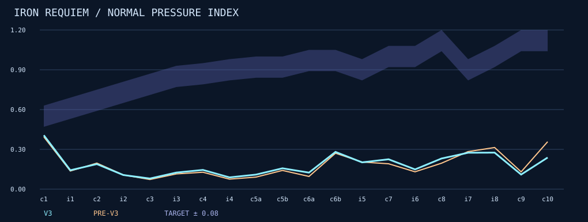

# Normal difficulty pressure

The index estimates enemy hull damage per phase divided by player hull damage per phase. Each unit contributes its strongest available attack across opposing hull and terrain matchups. It uses the actual combat forecast in Defend and discounts approach time by opening distance, speed and weapon reach. Both sides start with the campaign fixture’s canonical pilot levels, equipment, Will and upgrades.
Reinforcements add 35% of their headcount ratio to opening pressure. Escorts multiply pressure by 1.24 and other timed missions by 1.12. The estimate excludes future Spirit use, individual AI decisions and some scripted reinforcements. Use the campaign simulation to check the resulting turns and losses.

20 of 20 maps currently sit outside the target band. Pre-V3 and V3 use the same fixture levels and upgrades, with the respective skill systems.

| Map | Mission | Players/enemies | Scripted waves | Avg. enemy level | Pre-V3 | V3 | Target |
|---|---|---:|---:|---:|---:|---:|---:|
| c1 | Ashfall | 2/6 | 4 | 1 | 0.39 | 0.41 | 0.55 |
| i1 | The Shelter Line | 6/8 | 2 | 2 | 0.14 | 0.14 | 0.61 |
| c2 | Wings of the Halcyon | 6/7 | 0 | 3 | 0.20 | 0.19 | 0.67 |
| i2 | A Record of the Missing | 7/8 | 0 | 4 | 0.11 | 0.11 | 0.73 |
| c3 | The Kaiser Awakens | 7/7 | 3 | 4 | 0.07 | 0.08 | 0.79 |
| i3 | The Second Shift | 7/9 | 0 | 6 | 0.11 | 0.13 | 0.85 |
| c4 | Crimson Hound | 8/8 | 0 | 8 | 0.13 | 0.14 | 0.87 |
| i4 | Names Above the Clouds | 8/9 | 0 | 9 | 0.08 | 0.09 | 0.90 |
| c5a | Under the Crust | 8/7 | 2 | 10 | 0.09 | 0.11 | 0.92 |
| c5b | Colony Requiem | 8/8 | 1 | 11 | 0.14 | 0.16 | 0.92 |
| c6a | The Song Below | 8/9 | 0 | 13 | 0.10 | 0.12 | 0.97 |
| c6b | Lethe's Shadow | 8/9 | 0 | 13 | 0.27 | 0.28 | 0.97 |
| i5 | A Voice Outside the Choir | 8/9 | 0 | 15 | 0.20 | 0.20 | 0.90 |
| c7 | The Vael Herald | 8/8 | 0 | 16 | 0.19 | 0.23 | 1.00 |
| i6 | The Molting Choir | 8/12 | 0 | 18 | 0.13 | 0.15 | 1.00 |
| c8 | Sovereign | 8/10 | 0 | 19 | 0.20 | 0.23 | 1.12 |
| i7 | The Weight of an Order | 8/12 | 0 | 21 | 0.28 | 0.27 | 0.90 |
| i8 | What the Dark Repeats | 8/11 | 0 | 23 | 0.31 | 0.28 | 1.00 |
| c9 | Requiem for Iron | 9/8 | 3 | 22 | 0.13 | 0.11 | 1.12 |
| c10 | Fourth Dawn | 9/7 | 2 | 26 | 0.36 | 0.24 | 1.12 |
